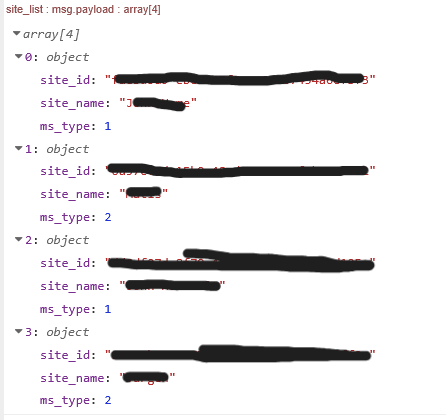

# node-red-contrib-anker-solix – Deutsche Anleitung

⬅️ [Zurück zur Hauptseite](README.md) | 🇬🇧 [English Documentation](README.en.md)

---

## Inhaltsverzeichnis

1. [Installation](#installation)
2. [Grundeinrichtung](#grundeinrichtung)
3. [Mehrere Anlagen einrichten (`SITE_ID` & `get_sites`)](#mehrere-anlagen-einrichten-site_id--get_sites)
4. [Hardware-Erkennung, Schlafmodus & Akkuschutz](#hardware-erkennung-schlafmodus--akkuschutz)
5. [Ausgang 1: Universelles Nachrichtenformat & Smart-Home-Beispiele](#ausgang-1-universelles-nachrichtenformat--smart-home-beispiele)
6. [Kopierbare JSON-Vorlage](#kopierbare-json-vorlage)
7. [Vollständige Übersicht aller 124 Datenpunkte](#vollständige-übersicht-aller-124-datenpunkte)
8. [Praxis-Ergebnis](#praxis-ergebnis)

---

## Installation

Installiere den Baustein direkt über den **Node-RED Paletten-Manager** (Suche nach `node-red-contrib-anker-solix`) oder per SSH / Terminal in deinem Node-RED-Datenverzeichnis (z. B. `/usr/local/addons/redmatic/var` unter OpenCCU / RedMatic):

```bash
npm install node-red-contrib-anker-solix
```

Importiere anschließend den fertigen Beispielflow über **Node-RED Menü > Import > Beispiele > node-red-contrib-anker-solix**.


---

## Grundeinrichtung

Öffne die Eigenschaften des Bausteins und trage deine **Anker SOLIX EU-Zugangsdaten** (E-Mail und Passwort) ein.

* **Einzelne Anlage (`ms_type === 1`):** Lasse das Feld `SITE_ID (optional)` leer. Der Baustein erkennt deine Hauptanlage automatisch und speichert die ID lokal zwischen.
* **Seriennummern der Geräte:** Lasse `Wakeup SN/PN` und `Solarbank 1–4 SN` für die automatische Erkennung leer oder trage gezielt Seriennummern ein, um die Auto-Erkennung zu überschreiben.
* **Konten-Empfehlung (Zweitkonto vs. Hauptkonto):** Für das reine Auslesen von Live- und Statistikdaten wird weiterhin ein kostenloses, geteiltes **Zweitkonto** empfohlen (maximale Sicherheit und saubere Trennung). Das **Hauptkonto (Eigentümer)** ist nur dann erforderlich, wenn später (ab `v1.1.0`) Schreibbefehle / Steuerungen an die Anlage gesendet werden sollen. Anker erlaubt inzwischen parallele Logins von Smartphone-App und Node-RED gleichzeitig.


---

## Mehrere Anlagen einrichten (`SITE_ID` & `get_sites`)

Wenn du **zwei oder mehr Anlagen** abfragen möchtest (z. B. eine zweite eigene Anlage oder geteilte Familienanlagen), **musst** du in jedem Baustein die jeweilige `SITE_ID` eintragen. Bleibt das Feld leer, greifen alle Bausteine immer auf dieselbe erste Hauptanlage zu.

1. Löse den Inject-Baustein mit `msg.topic = "get_sites"` aus.
2. Lies die Liste aller verfügbaren `site_id`-Werte am **Ausgang 3** im Debug-Fenster aus.
3. Kopiere die gewünschte `site_id` in das Feld `SITE_ID (optional)` des jeweiligen Bausteins.



---

## Hardware-Erkennung, Schlafmodus & Akkuschutz

Anker SOLIX Solarbanks wechseln nachts in einen **Tiefschlafmodus (Sleep Mode)**, sobald der Akku die eingestellte Entladegrenze (`Reserve-SOC`, z. B. `5 %` oder `10 %`) erreicht, und wachen erst morgens wieder auf, sobald Solarstrom anliegt. Würde man eine reine Solarbank nachts per Cloud aufwecken, würde ihr Akku unnötig entladen.

* **Anlagen mit Power Dock (`AE100`), Anker Smart Meter (`A17X7`, `A17X8`, `AE1X0`, `AE1R0`, `SHEM3`) oder 230V-Heimspeicher (`AE111`, `A17E2`, `B17E2`):** Diese Geräte hängen dauerhaft am 230V-Hausnetz. Der Baustein nutzt sie automatisch als Wakeup-Master (`cmd: 17` mit Zufalls-Jitter `3–4 Min.` sowie automatischem Stillstands-Re-Trigger nach 90 Sekunden) für lückenlose 5-Sekunden-Echtzeitdaten, während verbundene Solarbanks sicher ruhen dürfen.
* **Reine Solarbank-Anlagen (ohne Power Dock / Anker Smart Meter):** Der Baustein schaltet den MQTT-Wakeup ab Werk automatisch aus (`OK (Akkuschutz: Wakeup aus)`).
* **Steuer-Topics im laufenden Betrieb:**
  * `msg.topic = "set_wakeup"`, `msg.payload = true` (Wakeup einschalten, z. B. tagsüber per Astro-Zeitplan)
  * `msg.topic = "set_wakeup"`, `msg.payload = false` (Wakeup ausschalten)
  * `msg.topic = "set_wakeup"`, `msg.payload = "auto"` (zurück zur automatischen Hardware-Erkennung)
  * `msg.topic = "get_stats"` (Energie-Statistiken in `kWh` sofort abrufen, ohne auf das 300-Sekunden-Intervall zu warten)

---

## Ausgang 1: Universelles Nachrichtenformat & Smart-Home-Beispiele

Für jeden in der JSON-Konfiguration belegten Schlüssel sendet **Ausgang 1** bei Wertänderung – sowie alle **300 Sekunden** als Stützpunkt (verhindert Spline-Wellen in CCU-Historian bei Konstantphasen) – eine standardisierte Node-RED-Nachricht:

```json
{
  "topic": "Dein_Eingetragener_Zielname",
  "payload": 1245
}
```

*(Hinweis: **Ausgang 2** liefert zusätzlich die ungefilterten Rohdaten der API als JSON-Objekte mit `msg.topic = "scen_info"` bzw. `msg.topic = "energy_analysis"`.)*


| Zielsystem | Beispiel-Eintrag in der JSON-Vorlage | Verbundener Baustein an Ausgang 1 |
| :--- | :--- | :--- |
| **OpenCCU / HomeMatic** | `"PD_HAUSLAST": "Leistung Hauslast"` | **`ccu-sysvar`** (nutzt `msg.topic` als Variablennamen und `msg.payload` als Wert) |
| **MQTT-Broker** *(Home Assistant, ioBroker)* | `"PD_HAUSLAST": "anker/solix/hauslast"` | **`mqtt out`** (Topic im MQTT-Node leer lassen; nutzt automatisch `msg.topic`) |
| **InfluxDB / Grafana** | `"PD_HAUSLAST": "hauslast_w"` | **`influxdb out`** (schreibt `msg.payload` unter dem Feldnamen aus `msg.topic`) |
| **KNX / Loxone** | `"PD_HAUSLAST": "1/2/10"` | **`knxUltimate`** oder **`loxone-control-out`** |
---

## Kopierbare JSON-Vorlage

```json
{
  "_ANLEITUNG_1": "Trage hinter dem Doppelpunkt den Namen deiner OpenCCU-Systemvariable (oder z.B. dein MQTT-Topic) ein. Leere Felder werden ignoriert.",
  "_BEREICH_POWERDOCK": "--- GESAMT / POWER DOCK LIVE (Einheit: W bzw. %) ---",
  "PD_HAUSLAST": "",
  "PD_NETZ_BEZUG": "",
  "PD_NETZ_EINSP": "",
  "PD_SOC": "",
  "PD_LADEN": "",
  "PD_SOLAR": "",
  "PD_ENTLADEN": "",
  "PD_AUSGANG": "",
  "_BEREICH_SB1": "--- SOLARBANK 1 LIVE (Einheit: W, % bzw. °C) ---",
  "SB1_SOC": "",
  "SB1_SOLAR": "",
  "SB1_LADEN": "",
  "SB1_OUTPUT": "",
  "SB1_TEMP": "",
  "SB1_PV1": "",
  "SB1_PV2": "",
  "SB1_PV3": "",
  "SB1_PV4": "",
  "_BEREICH_SB2": "--- SOLARBANK 2 LIVE (Einheit: W, % bzw. °C) ---",
  "SB2_SOC": "",
  "SB2_SOLAR": "",
  "SB2_LADEN": "",
  "SB2_OUTPUT": "",
  "SB2_TEMP": "",
  "SB2_PV1": "",
  "SB2_PV2": "",
  "SB2_PV3": "",
  "SB2_PV4": "",
  "_BEREICH_SB3": "--- SOLARBANK 3 LIVE (Einheit: W, % bzw. °C) ---",
  "SB3_SOC": "",
  "SB3_SOLAR": "",
  "SB3_LADEN": "",
  "SB3_OUTPUT": "",
  "SB3_TEMP": "",
  "SB3_PV1": "",
  "SB3_PV2": "",
  "SB3_PV3": "",
  "SB3_PV4": "",
  "_BEREICH_SB4": "--- SOLARBANK 4 LIVE (Einheit: W, % bzw. °C) ---",
  "SB4_SOC": "",
  "SB4_SOLAR": "",
  "SB4_LADEN": "",
  "SB4_OUTPUT": "",
  "SB4_TEMP": "",
  "SB4_PV1": "",
  "SB4_PV2": "",
  "SB4_PV3": "",
  "SB4_PV4": "",
  "_BEREICH_STAT_GESAMT": "--- STATISTIK GESAMT (Einheit: kWh) ---",
  "STAT_GES_TAG_SOLAR": "",
  "STAT_GES_TAG_LADEN": "",
  "STAT_GES_TAG_ENTLADEN": "",
  "STAT_GES_TAG_SOLAR_HAUS": "",
  "STAT_GES_TAG_EINSP": "",
  "STAT_GES_TAG_NETZ": "",
  "STAT_GES_TAG_HAUS": "",
  "STAT_GES_TAG_BAT_HAUS": "",
  "STAT_GES_WOCHE_SOLAR": "",
  "STAT_GES_WOCHE_LADEN": "",
  "STAT_GES_WOCHE_ENTLADEN": "",
  "STAT_GES_WOCHE_SOLAR_HAUS": "",
  "STAT_GES_WOCHE_EINSP": "",
  "STAT_GES_WOCHE_NETZ": "",
  "STAT_GES_WOCHE_HAUS": "",
  "STAT_GES_WOCHE_BAT_HAUS": "",
  "STAT_GES_MONAT_SOLAR": "",
  "STAT_GES_MONAT_LADEN": "",
  "STAT_GES_MONAT_ENTLADEN": "",
  "STAT_GES_MONAT_SOLAR_HAUS": "",
  "STAT_GES_MONAT_EINSP": "",
  "STAT_GES_MONAT_NETZ": "",
  "STAT_GES_MONAT_HAUS": "",
  "STAT_GES_MONAT_BAT_HAUS": "",
  "STAT_GES_JAHR_SOLAR": "",
  "STAT_GES_JAHR_LADEN": "",
  "STAT_GES_JAHR_ENTLADEN": "",
  "STAT_GES_JAHR_SOLAR_HAUS": "",
  "STAT_GES_JAHR_EINSP": "",
  "STAT_GES_JAHR_NETZ": "",
  "STAT_GES_JAHR_HAUS": "",
  "STAT_GES_JAHR_BAT_HAUS": "",
  "_BEREICH_STAT_SB1": "--- STATISTIK SOLARBANK 1 (Einheit: kWh) ---",
  "STAT_SB1_TAG_SOLAR": "",
  "STAT_SB1_TAG_LADEN": "",
  "STAT_SB1_TAG_ENTLADEN": "",
  "STAT_SB1_WOCHE_SOLAR": "",
  "STAT_SB1_WOCHE_LADEN": "",
  "STAT_SB1_WOCHE_ENTLADEN": "",
  "STAT_SB1_MONAT_SOLAR": "",
  "STAT_SB1_MONAT_LADEN": "",
  "STAT_SB1_MONAT_ENTLADEN": "",
  "STAT_SB1_JAHR_SOLAR": "",
  "STAT_SB1_JAHR_LADEN": "",
  "STAT_SB1_JAHR_ENTLADEN": "",
  "_BEREICH_STAT_SB2": "--- STATISTIK SOLARBANK 2 (Einheit: kWh) ---",
  "STAT_SB2_TAG_SOLAR": "",
  "STAT_SB2_TAG_LADEN": "",
  "STAT_SB2_TAG_ENTLADEN": "",
  "STAT_SB2_WOCHE_SOLAR": "",
  "STAT_SB2_WOCHE_LADEN": "",
  "STAT_SB2_WOCHE_ENTLADEN": "",
  "STAT_SB2_MONAT_SOLAR": "",
  "STAT_SB2_MONAT_LADEN": "",
  "STAT_SB2_MONAT_ENTLADEN": "",
  "STAT_SB2_JAHR_SOLAR": "",
  "STAT_SB2_JAHR_LADEN": "",
  "STAT_SB2_JAHR_ENTLADEN": "",
  "_BEREICH_STAT_SB3": "--- STATISTIK SOLARBANK 3 (Einheit: kWh) ---",
  "STAT_SB3_TAG_SOLAR": "",
  "STAT_SB3_TAG_LADEN": "",
  "STAT_SB3_TAG_ENTLADEN": "",
  "STAT_SB3_WOCHE_SOLAR": "",
  "STAT_SB3_WOCHE_LADEN": "",
  "STAT_SB3_WOCHE_ENTLADEN": "",
  "STAT_SB3_MONAT_SOLAR": "",
  "STAT_SB3_MONAT_LADEN": "",
  "STAT_SB3_MONAT_ENTLADEN": "",
  "STAT_SB3_JAHR_SOLAR": "",
  "STAT_SB3_JAHR_LADEN": "",
  "STAT_SB3_JAHR_ENTLADEN": "",
  "_BEREICH_STAT_SB4": "--- STATISTIK SOLARBANK 4 (Einheit: kWh) ---",
  "STAT_SB4_TAG_SOLAR": "",
  "STAT_SB4_TAG_LADEN": "",
  "STAT_SB4_TAG_ENTLADEN": "",
  "STAT_SB4_WOCHE_SOLAR": "",
  "STAT_SB4_WOCHE_LADEN": "",
  "STAT_SB4_WOCHE_ENTLADEN": "",
  "STAT_SB4_MONAT_SOLAR": "",
  "STAT_SB4_MONAT_LADEN": "",
  "STAT_SB4_MONAT_ENTLADEN": "",
  "STAT_SB4_JAHR_SOLAR": "",
  "STAT_SB4_JAHR_LADEN": "",
  "STAT_SB4_JAHR_ENTLADEN": ""
}
```

---

## Vollständige Übersicht aller 124 Datenpunkte

### Gesamtsystem / Power Dock Live (8 Werte)
* `PD_HAUSLAST` (W): Aktuelle Hauslast
* `PD_NETZ_BEZUG` (W): Aktueller Netzbezug
* `PD_NETZ_EINSP` (W): Aktuelle Netzeinspeisung
* `PD_SOC` (%): Gesamter Akkustand
* `PD_LADEN` (W): Gesamte Ladeleistung
* `PD_SOLAR` (W): Gesamte PV-Solarleistung
* `PD_ENTLADEN` (W): Gesamte Entladeleistung
* `PD_AUSGANG` (W): Gesamte Ausgangsleistung

### Einzelne Solarbanks 1–4 Live (4 × 9 = 36 Werte)
*(Ersetze `X` durch `1`, `2`, `3` oder `4`)*
* `SBX_SOC` (%): Akkustand der Solarbank X
* `SBX_SOLAR` (W): Gesamte Solarleistung der Solarbank X
* `SBX_LADEN` (W): Ladeleistung der Solarbank X
* `SBX_OUTPUT` (W): Ausgangsleistung der Solarbank X
* `SBX_TEMP` (°C): Akkutemperatur der Solarbank X
* `SBX_PV1` .. `SBX_PV4` (W): Einzelleistung der PV-Eingänge 1–4

### Energie-Statistiken Gesamt (4 Zeiträume × 8 = 32 Werte, Einheit: `kWh`)
*(Ersetze `ZEITRAUM` durch `TAG`, `WOCHE`, `MONAT` oder `JAHR`)*
* `STAT_GES_ZEITRAUM_SOLAR` (kWh): Gesamter Solarertrag
* `STAT_GES_ZEITRAUM_LADEN` (kWh): In den Akku geladene Energie
* `STAT_GES_ZEITRAUM_ENTLADEN` (kWh): Aus dem Akku entladene Energie
* `STAT_GES_ZEITRAUM_SOLAR_HAUS` (kWh): Direkt verbrauchter Solarstrom im Haus
* `STAT_GES_ZEITRAUM_EINSP` (kWh): Ins Netz eingespeiste Energie
* `STAT_GES_ZEITRAUM_NETZ` (kWh): Aus dem Netz bezogene Energie
* `STAT_GES_ZEITRAUM_HAUS` (kWh): Gesamter Hausverbrauch
* `STAT_GES_ZEITRAUM_BAT_HAUS` (kWh): Aus dem Akku gedeckter Hausverbrauch

### Energie-Statistiken Einzel-Solarbanks 1–4 (4 Bänke × 4 Zeiträume × 3 = 48 Werte, Einheit: `kWh`)
*(Ersetze `X` durch `1`–`4` und `ZEITRAUM` durch `TAG`, `WOCHE`, `MONAT` oder `JAHR`)*
* `STAT_SBX_ZEITRAUM_SOLAR` (kWh): Solarertrag der Solarbank X
* `STAT_SBX_ZEITRAUM_LADEN` (kWh): Geladene Energie der Solarbank X
* `STAT_SBX_ZEITRAUM_ENTLADEN` (kWh): Entladene Energie der Solarbank X

---

## Praxis-Ergebnis

Lückenlose 5-Sekunden-Echtzeitaufzeichnung im CCU-Historian ohne Cloud-Wellen:


