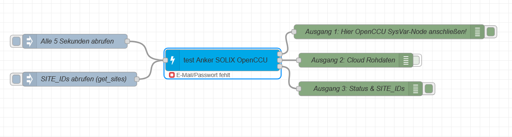
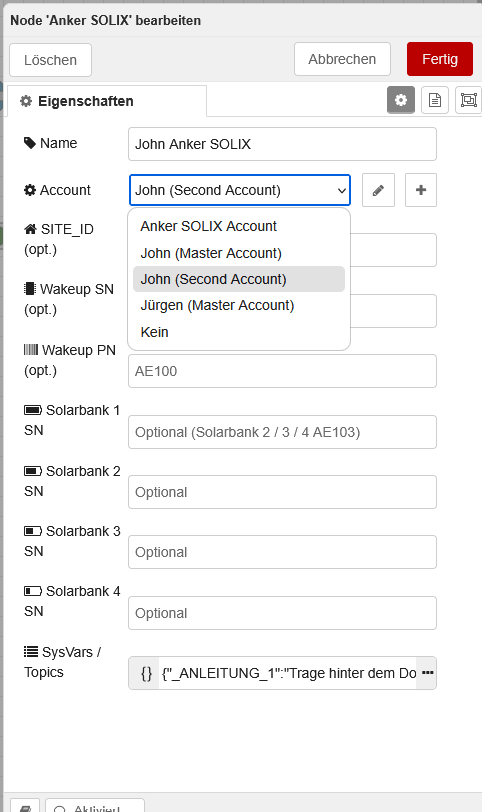
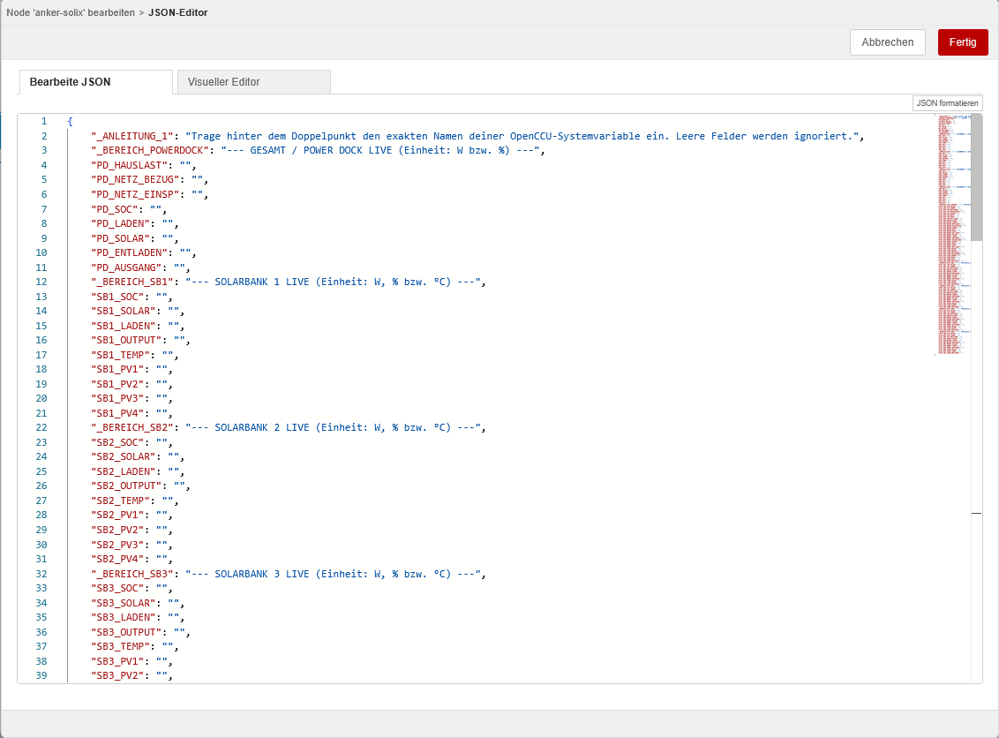
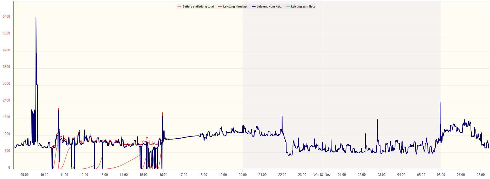

# node-red-contrib-anker-solix – Deutsche Anleitung

⬅️ [Zurück zur Hauptseite](README.md) | 🇬🇧 [English Documentation](README.en.md)

---

## Inhaltsverzeichnis

1. [Installation](#installation)
2. [Update-Hinweis (`v1.0.x` → `v1.1.x`)](#update-hinweis-v10x--v11x)
3. [Grundeinrichtung & Account-Node (`anker-solix-config`)](#grundeinrichtung--account-node-anker-solix-config)
4. [Mehrere Anlagen einrichten (`SITE_ID` & `get_sites`)](#mehrere-anlagen-einrichten-site_id--get_sites)
5. [Steuerungs-Baustein (`anker-solix-control`)](#steuerungs-baustein-anker-solix-control)
6. [Hardware-Erkennung, Schlafmodus & Akkuschutz](#hardware-erkennung-schlafmodus--akkuschutz)
7. [Ausgang 1: Universelles Nachrichtenformat & Smart-Home-Beispiele](#ausgang-1-universelles-nachrichtenformat--smart-home-beispiele)
8. [Kopierbare JSON-Vorlage (126 Keys)](#kopierbare-json-vorlage-126-keys)
9. [Vollständige Übersicht aller 126 Datenpunkte](#vollständige-übersicht-aller-126-datenpunkte)
10. [Praxis-Ergebnis](#praxis-ergebnis)

---

## Installation

Installiere das Paket direkt über den **Node-RED Paletten-Manager** (Suche nach `node-red-contrib-anker-solix`) oder per SSH / Terminal in deinem Node-RED-Datenverzeichnis (z. B. `/usr/local/addons/redmatic/var` unter OpenCCU / RedMatic):

`npm install node-red-contrib-anker-solix`

Importiere anschließend einen fertigen Beispielflow über **Node-RED Menü > Import > Beispiele > node-red-contrib-anker-solix**.



---

## Update-Hinweis (`v1.0.x` → `v1.1.x`)

Ab `v1.1.0` sind die Cloud-Zugangsdaten in einen eigenen zentralen **Account-Config-Node (`anker-solix-config`)** ausgelagert, damit mehrere Daten- und Steuerungs-Nodes ein gemeinsames Konto nutzen können:

1. Öffne nach dem Update einmalig deinen bestehenden **`Anker SOLIX`**-Datenbaustein.
2. Klicke neben dem Feld **Account** auf das **Stift-Symbol**, trage **Email**, **Password** sowie **Region** (`EU`, `US`, `AU`, `CN`) ein und klicke auf **Hinzufügen / Aktualisieren**.
3. Klicke auf **Übernahme (Deploy)** – fertig!

* **Volle Abwärtskompatibilität:** Alle bestehenden `SysVars / Topics`-Zuordnungen (inklusive der bisherigen deutschen Keys wie `PD_HAUSLAST`, `SB1_LADEN`, `STAT_GES_TAG_*`), `SITE_ID`, Seriennummern und Flow-Verbindungen bleiben zu 100 % erhalten und laufen ohne Umstellung weiter.

---

## Grundeinrichtung & Account-Node (`anker-solix-config`)

1. Ziehe den Daten-Baustein **`Anker SOLIX`** in deinen Flow und öffne seine Eigenschaften.
2. Lege über das Stift-Symbol neben **Account** deinen **Anker SOLIX Account** an:
   * **Email & Password:** Deine Anker SOLIX App-Zugangsdaten (werden verschlüsselt in Node-RED gespeichert).
   * **Region:** Server-Region deines Kontos (`EU` für Europa/UK, `US` für Nordamerika, `AU` für Australien, `CN` für China).
   * **Timezone:** Zeitzone deiner Anlage (z. B. `Europe/Berlin`).
3. **Einzelne Anlage (`ms_type === 1`):** Lasse das Feld `SITE_ID (opt.)` im Daten-Baustein leer. Der Baustein erkennt deine Hauptanlage automatisch und speichert die ID lokal zwischen.
4. **Seriennummern der Geräte:** Lasse `Wakeup SN/PN` und `Solarbank 1–4 SN` für die automatische Erkennung leer oder trage gezielt Seriennummern ein, um die Auto-Erkennung zu überschreiben.
5. **Konten-Empfehlung (Zweitkonto, Wakeup Account & Hauptkonto):** Für das reine 24/7-Auslesen von Live- und Statistikdaten wird ein kostenloses, geteiltes **Zweitkonto** unter **Account** empfohlen. Über das optionale Feld **Wakeup Account** kannst du zusätzlich das **Hauptkonto (Eigentümer, `ms_type === 1`)** für die MQTT-Wakeup-Pings hinterlegen, damit kontinuierliche 5-Sekunden-Werte auch nach App-Änderungen stabil bleiben. Das **Hauptkonto** ist außerdem für den Steuerungs-Baustein **`Anker SOLIX Control`** erforderlich.


---

## Mehrere Anlagen einrichten (`SITE_ID` & `get_sites`)

Du benötigst für mehrere Anlagen **nur einen einzigen Account-Config-Node** (sofern alle Anlagen in diesem Konto sichtbar sind). Jede Anker-Anlage besitzt eine weltweit eindeutige `SITE_ID`:

1. Löse den Inject-Baustein mit `msg.topic = "get_sites"` aus.
2. Lies die Liste aller verfügbaren `site_id`-Werte am **Ausgang 3** im Debug-Fenster aus.
3. Trage die jeweilige `site_id` direkt in das Feld `SITE_ID (opt.)` des entsprechenden Daten- bzw. Steuerungs-Bausteins ein.
4. Wenn mehrere Daten-Nodes gleichzeitig über einen gemeinsamen 5-Sekunden-Inject getriggert werden, sorgt ein automatischer **Multi-Instanz-Start-Versatz (`0–1.500 ms`)** für eine saubere, versetzte API-Abfrage ohne zusätzliche Delay-Nodes.


---

## Steuerungs-Baustein (`anker-solix-control`)

Mit dem Baustein **`Anker SOLIX Control`** lassen sich Betriebsmodi und Ausgangsleistungen direkt aus Node-RED heraus umschalten. Er unterstützt automatisch **Power Dock (`AE100`)**, **Solarbank 4 E5000 Pro (`AE103`)**, **Solarbank 3 Pro (`A17C5`)**, **Solarbank 2** sowie **Solarbank 1 (`A17C0`)**.

* **Wichtig:** Für Schreibbefehle muss im Control-Node das **Hauptkonto (Eigentümer, `ms_type === 1`)** ausgewählt sein. Bei geteilten Mitbenutzer-Anlagen meldet der Baustein automatisch, dass nur der Eigentümer steuern darf.
* **Sofort-Aktualisierung:** Nach jedem erfolgreichen Steuerbefehl wird der Wakeup-Lock der Anlage sofort zurückgesetzt, sodass der Daten-Baustein den neuen Zustand unmittelbar ausliest.

### Unterstützte Befehle (`Command` bzw. `msg.topic`)

| Befehl (`msg.topic`) | Werte (`msg.payload`) | Beschreibung |
| :--- | :--- | :--- |
| **`set_usage_mode`** | `1`, `2`, `3` oder `7` | Wechselt den Betriebsmodus der Anlage:<br>• `1` = **Self-Consumption / Smart Meter** (Eigenverbrauch)<br>• `2` = **Custom Mode / Schedule** (Benutzerdefiniert / Manuell – legt automatisch einen 24h-Standard-Zeitplan `00:00–24:00` an, falls noch keiner existiert; individuelle Zeitfenster in der Anker-App pflegen)<br>• `3` = **Smart Plug / Time-of-Use**<br>• `7` = **Smart Mode / AI EMS** (KI-Modus) |
| **`set_output_power`** | `0` .. `4800` *(Watt)* | Setzt die Einspeise-/Ausgangsleistung in Watt (primär für Einzel-Solarbanks ohne Power Dock; wird auf `0..800 W` bei Gen 1 bzw. `0..max_load` / `4800 W` begrenzt und auf den Geräteschritt `step` gerundet). |
| **`from_msg`** | `{ command, value }` | Dynamische Steuerung per JSON-Objekt oder direkt über `msg.topic` + `msg.payload`. |
| **`get_params`** | *(beliebig)* | Liest die aktuellen Geräteparameter (`param_type` `6` bzw. `4`) zur Diagnose aus. |

---

## Hardware-Erkennung, Schlafmodus & Akkuschutz

Anker SOLIX Solarbanks wechseln nachts in einen **Tiefschlafmodus (Sleep Mode)**, sobald der Akku die eingestellte Entladegrenze erreicht, und wachen erst morgens wieder auf, sobald Solarstrom anliegt.

* **Anlagen mit Power Dock (`AE100`), Anker Smart Meter (`A17X7`, `A17X8`, `AE1X0`, `AE1R0`, `SHEM3`) oder 230V-Heimspeicher (`AE111`, `A17E1`, `A17E2`, `B17E2`):** Diese Geräte hängen dauerhaft am Hausnetz. Der Baustein nutzt sie automatisch als Wakeup-Master (`cmd: 17` mit Zufalls-Jitter `3–4 Min.` sowie automatischem Stillstands-Re-Trigger nach 90 Sekunden) für lückenlose 5-Sekunden-Echtzeitdaten, während verbundene Solarbanks sicher ruhen dürfen.
* **Reine Solarbank-Anlagen (ohne Power Dock / Anker Smart Meter):** Der Baustein schaltet den MQTT-Wakeup ab Werk automatisch aus (`OK (Battery protection: wakeup off)`).
* **Hinweis bei Rückfall auf 5-Minuten-Werte (Konstellationsbestätigung):** Falls trotz aktivem MQTT-Wakeup wieder 5-Minuten-Wellen im Verlauf auftreten, öffne die Anker-App einmal mit dem **Hauptkonto (`ms_type === 1`)** und prüfe/bestätige dort die Geräte- bzw. Anlagenkonstellation.
* **Smart-Meter-Ausfall-Überwachung:** Der Datenpunkt `SITE_SMARTMETER_ONLINE` meldet `1` (online) oder `0` (offline / 200W-Notbetrieb aktiv). Zusätzlich sendet **Ausgang 3** bei jedem Statuswechsel einmalig eine Alarm-Nachricht (`msg.topic = "alarm/smartmeter_offline"` bzw. `"alarm/smartmeter_online"`).
* **Laufzeit-Topics am Daten-Baustein:**
  * `msg.topic = "set_wakeup"`, `msg.payload = true` / `false` / `"auto"` (MQTT-Wakeup manuell ein-, ausschalten oder zurück auf Automatik)
  * `msg.topic = "get_stats"` (Energie-Statistiken in `kWh` sofort abrufen)
  * `msg.topic = "get_sites"` (Alle `SITE_IDs` an Ausgang 3 ausgeben)

---

## Ausgang 1: Universelles Nachrichtenformat & Smart-Home-Beispiele

Für jeden belegten Schlüssel sendet **Ausgang 1** bei Wertänderung – sowie alle **300 Sekunden** als Stützpunkt (verhindert Spline-Wellen in CCU-Historian bei Konstantphasen) – eine standardisierte Node-RED-Nachricht (`{ topic: "Dein_Zielname", payload: 1245 }`).



| Zielsystem | Beispiel-Eintrag in der JSON-Vorlage | Verbundener Baustein an Ausgang 1 |
| :--- | :--- | :--- |
| **OpenCCU / HomeMatic** | `"SITE_HOME_LOAD": "Leistung Hauslast"` | **`ccu-sysvar`** (nutzt `msg.topic` als Variablennamen und `msg.payload` als Wert) |
| **MQTT-Broker** *(Home Assistant, ioBroker)* | `"SITE_HOME_LOAD": "anker/solix/home_load"` | **`mqtt out`** (Topic im MQTT-Node leer lassen; nutzt automatisch `msg.topic`) |
| **InfluxDB / Grafana** | `"SITE_HOME_LOAD": "home_load_w"` | **`influxdb out`** (schreibt `msg.payload` unter dem Feldnamen aus `msg.topic`) |
| **KNX / Loxone** | `"SITE_HOME_LOAD": "1/2/10"` | **`knxUltimate`** oder **`loxone-control-out`** |

---

## Kopierbare JSON-Vorlage (126 Keys)

```json
{
  "_INFO_1": "Trage nach dem Doppelpunkt den Namen deiner OpenCCU-Systemvariable (oder das MQTT-Topic) ein. Leere Felder werden ignoriert.",
  "_SECTION_SITE": "--- SITE / TOTAL LIVE (Unit: W, % or 0/1) ---",
  "SITE_HOME_LOAD": "", "SITE_GRID_IMPORT": "", "SITE_GRID_EXPORT": "", "SITE_SOC": "",
  "SITE_CHARGE": "", "SITE_AC_CHARGE": "", "SITE_SOLAR": "", "SITE_DISCHARGE": "",
  "SITE_OUTPUT": "", "SITE_SMARTMETER_ONLINE": "",
  "_SECTION_SB1": "--- SOLARBANK 1 LIVE (Unit: W or %) ---",
  "SB1_SOC": "", "SB1_SOLAR": "", "SB1_CHARGE": "", "SB1_AC_CHARGE": "", "SB1_OUTPUT": "",
  "SB1_PV1": "", "SB1_PV2": "", "SB1_PV3": "", "SB1_PV4": "",
  "_SECTION_SB2": "--- SOLARBANK 2 LIVE (Unit: W or %) ---",
  "SB2_SOC": "", "SB2_SOLAR": "", "SB2_CHARGE": "", "SB2_AC_CHARGE": "", "SB2_OUTPUT": "",
  "SB2_PV1": "", "SB2_PV2": "", "SB2_PV3": "", "SB2_PV4": "",
  "_SECTION_SB3": "--- SOLARBANK 3 LIVE (Unit: W or %) ---",
  "SB3_SOC": "", "SB3_SOLAR": "", "SB3_CHARGE": "", "SB3_AC_CHARGE": "", "SB3_OUTPUT": "",
  "SB3_PV1": "", "SB3_PV2": "", "SB3_PV3": "", "SB3_PV4": "",
  "_SECTION_SB4": "--- SOLARBANK 4 LIVE (Unit: W or %) ---",
  "SB4_SOC": "", "SB4_SOLAR": "", "SB4_CHARGE": "", "SB4_AC_CHARGE": "", "SB4_OUTPUT": "",
  "SB4_PV1": "", "SB4_PV2": "", "SB4_PV3": "", "SB4_PV4": "",
  "_SECTION_STAT_SITE": "--- SITE STATISTICS (Unit: kWh) ---",
  "STAT_DAY_SOLAR": "", "STAT_DAY_CHARGE": "", "STAT_DAY_DISCHARGE": "", "STAT_DAY_SOLAR_HOME": "",
  "STAT_DAY_GRID_EXPORT": "", "STAT_DAY_GRID_IMPORT": "", "STAT_DAY_HOME": "", "STAT_DAY_BAT_HOME": "",
  "STAT_WEEK_SOLAR": "", "STAT_WEEK_CHARGE": "", "STAT_WEEK_DISCHARGE": "", "STAT_WEEK_SOLAR_HOME": "",
  "STAT_WEEK_GRID_EXPORT": "", "STAT_WEEK_GRID_IMPORT": "", "STAT_WEEK_HOME": "", "STAT_WEEK_BAT_HOME": "",
  "STAT_MONTH_SOLAR": "", "STAT_MONTH_CHARGE": "", "STAT_MONTH_DISCHARGE": "", "STAT_MONTH_SOLAR_HOME": "",
  "STAT_MONTH_GRID_EXPORT": "", "STAT_MONTH_GRID_IMPORT": "", "STAT_MONTH_HOME": "", "STAT_MONTH_BAT_HOME": "",
  "STAT_YEAR_SOLAR": "", "STAT_YEAR_CHARGE": "", "STAT_YEAR_DISCHARGE": "", "STAT_YEAR_SOLAR_HOME": "",
  "STAT_YEAR_GRID_EXPORT": "", "STAT_YEAR_GRID_IMPORT": "", "STAT_YEAR_HOME": "", "STAT_YEAR_BAT_HOME": "",
  "_SECTION_STAT_SB1": "--- SOLARBANK 1 STATISTICS (Unit: kWh) ---",
  "STAT_SB1_DAY_SOLAR": "", "STAT_SB1_DAY_CHARGE": "", "STAT_SB1_DAY_DISCHARGE": "",
  "STAT_SB1_WEEK_SOLAR": "", "STAT_SB1_WEEK_CHARGE": "", "STAT_SB1_WEEK_DISCHARGE": "",
  "STAT_SB1_MONTH_SOLAR": "", "STAT_SB1_MONTH_CHARGE": "", "STAT_SB1_MONTH_DISCHARGE": "",
  "STAT_SB1_YEAR_SOLAR": "", "STAT_SB1_YEAR_CHARGE": "", "STAT_SB1_YEAR_DISCHARGE": "",
  "_SECTION_STAT_SB2": "--- SOLARBANK 2 STATISTICS (Unit: kWh) ---",
  "STAT_SB2_DAY_SOLAR": "", "STAT_SB2_DAY_CHARGE": "", "STAT_SB2_DAY_DISCHARGE": "",
  "STAT_SB2_WEEK_SOLAR": "", "STAT_SB2_WEEK_CHARGE": "", "STAT_SB2_WEEK_DISCHARGE": "",
  "STAT_SB2_MONTH_SOLAR": "", "STAT_SB2_MONTH_CHARGE": "", "STAT_SB2_MONTH_DISCHARGE": "",
  "STAT_SB2_YEAR_SOLAR": "", "STAT_SB2_YEAR_CHARGE": "", "STAT_SB2_YEAR_DISCHARGE": "",
  "_SECTION_STAT_SB3": "--- SOLARBANK 3 STATISTICS (Unit: kWh) ---",
  "STAT_SB3_DAY_SOLAR": "", "STAT_SB3_DAY_CHARGE": "", "STAT_SB3_DAY_DISCHARGE": "",
  "STAT_SB3_WEEK_SOLAR": "", "STAT_SB3_WEEK_CHARGE": "", "STAT_SB3_WEEK_DISCHARGE": "",
  "STAT_SB3_MONTH_SOLAR": "", "STAT_SB3_MONTH_CHARGE": "", "STAT_SB3_MONTH_DISCHARGE": "",
  "STAT_SB3_YEAR_SOLAR": "", "STAT_SB3_YEAR_CHARGE": "", "STAT_SB3_YEAR_DISCHARGE": "",
  "_SECTION_STAT_SB4": "--- SOLARBANK 4 STATISTICS (Unit: kWh) ---",
  "STAT_SB4_DAY_SOLAR": "", "STAT_SB4_DAY_CHARGE": "", "STAT_SB4_DAY_DISCHARGE": "",
  "STAT_SB4_WEEK_SOLAR": "", "STAT_SB4_WEEK_CHARGE": "", "STAT_SB4_WEEK_DISCHARGE": "",
  "STAT_SB4_MONTH_SOLAR": "", "STAT_SB4_MONTH_CHARGE": "", "STAT_SB4_MONTH_DISCHARGE": "",
  "STAT_SB4_YEAR_SOLAR": "", "STAT_SB4_YEAR_CHARGE": "", "STAT_SB4_YEAR_DISCHARGE": ""
}
```
## Vollständige Übersicht aller 126 Datenpunkte

*(Alle bisherigen `1.0.x`-Keys wie `PD_HAUSLAST`, `SB1_LADEN`, `STAT_GES_TAG_*` werden intern automatisch über die Legacy-Alias-Brücke weiterhin unterstützt.)*

### Gesamtsystem / Site Live (10 Werte)
* `SITE_HOME_LOAD` (W): Aktuelle Hauslast *(Legacy: `PD_HAUSLAST`)*
* `SITE_GRID_IMPORT` (W): Aktueller Netzbezug *(Legacy: `PD_NETZ_BEZUG`)*
* `SITE_GRID_EXPORT` (W): Aktuelle Netzeinspeisung *(Legacy: `PD_NETZ_EINSP`)*
* `SITE_SOC` (%): Gesamter Akkustand *(Legacy: `PD_SOC`)*
* `SITE_CHARGE` (W): Gesamte Akku-Ladeleistung (PV + AC) *(Legacy: `PD_LADEN`)*
* `SITE_AC_CHARGE` (W): Gesamte AC-Netzladung der Speicher *(neu in v1.1.0)*
* `SITE_SOLAR` (W): Gesamte PV-Solarleistung *(Legacy: `PD_SOLAR`)*
* `SITE_DISCHARGE` (W): Gesamte Entladeleistung *(Legacy: `PD_ENTLADEN`)*
* `SITE_OUTPUT` (W): Gesamte Ausgangsleistung *(Legacy: `PD_AUSGANG`)*
* `SITE_SMARTMETER_ONLINE` (`1`/`0`): Smart-Meter-Verbindungsstatus (`1` = online, `0` = offline / 200W-Notbetrieb) *(neu in v1.1.0)*

### Einzelne Solarbanks 1–4 Live (4 × 9 = 36 Werte)
*(Ersetze `X` durch `1`, `2`, `3` oder `4`)*
* `SBX_SOC` (%): Akkustand der Solarbank X
* `SBX_SOLAR` (W): Gesamte PV-Solarleistung der Solarbank X
* `SBX_CHARGE` (W): Gesamte Ladeleistung der Solarbank X *(Legacy: `SBX_LADEN`)*
* `SBX_AC_CHARGE` (W): AC-Netzladung der Solarbank X *(neu in v1.1.0)*
* `SBX_OUTPUT` (W): Ausgangsleistung der Solarbank X
* `SBX_PV1` .. `SBX_PV4` (W): Einzelleistung der PV-Eingänge 1–4

### Energie-Statistiken Gesamt (4 Zeiträume × 8 = 32 Werte, Einheit: `kWh`)
*(Ersetze `PERIOD` durch `DAY`, `WEEK`, `MONTH` oder `YEAR` — Legacy: `TAG`, `WOCHE`, `MONAT`, `JAHR`)*
* `STAT_PERIOD_SOLAR` (kWh): Gesamter Solarertrag *(Legacy: `STAT_GES_*_SOLAR`)*
* `STAT_PERIOD_CHARGE` (kWh): In den Akku geladene Energie *(Legacy: `STAT_GES_*_LADEN`)*
* `STAT_PERIOD_DISCHARGE` (kWh): Aus dem Akku entladene Energie *(Legacy: `STAT_GES_*_ENTLADEN`)*
* `STAT_PERIOD_SOLAR_HOME` (kWh): Direkt verbrauchter Solarstrom im Haus *(Legacy: `STAT_GES_*_SOLAR_HAUS`)*
* `STAT_PERIOD_GRID_EXPORT` (kWh): Ins Netz eingespeiste Energie *(Legacy: `STAT_GES_*_EINSP`)*
* `STAT_PERIOD_GRID_IMPORT` (kWh): Aus dem Netz bezogene Energie *(Legacy: `STAT_GES_*_NETZ`)*
* `STAT_PERIOD_HOME` (kWh): Gesamter Hausverbrauch *(Legacy: `STAT_GES_*_HAUS`)*
* `STAT_PERIOD_BAT_HOME` (kWh): Aus dem Akku gedeckter Hausverbrauch *(Legacy: `STAT_GES_*_BAT_HAUS`)*

### Energie-Statistiken Einzel-Solarbanks 1–4 (4 Bänke × 4 Zeiträume × 3 = 48 Werte, Einheit: `kWh`)
*(Ersetze `X` durch `1`–`4` und `PERIOD` durch `DAY`, `WEEK`, `MONTH` oder `YEAR`)*
* `STAT_SBX_PERIOD_SOLAR` (kWh): Solarertrag der Solarbank X
* `STAT_SBX_PERIOD_CHARGE` (kWh): Geladene Energie der Solarbank X *(Legacy: `STAT_SBX_*_LADEN`)*
* `STAT_SBX_PERIOD_DISCHARGE` (kWh): Entladene Energie der Solarbank X *(Legacy: `STAT_SBX_*_ENTLADEN`)*

---

## Praxis-Ergebnis

Lückenlose 5-Sekunden-Echtzeitaufzeichnung im CCU-Historian ohne Cloud-Wellen:

