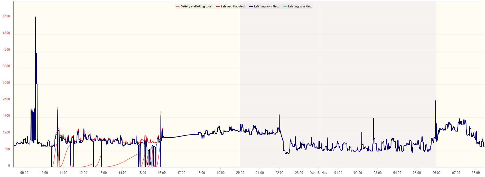

# node-red-contrib-anker-solix – English Documentation

⬅️ [Back to Main Page](README.md) | 🇩🇪 [Deutsche Anleitung](README.de.md)

---

## Table of Contents

1. [Installation](#installation)
2. [Basic Configuration](#basic-configuration)
3. [Multi-Site Setup (`SITE_ID` & `get_sites`)](#multi-site-setup-site_id--get_sites)
4. [Hardware Auto-Detection, Sleep Mode & Battery Protection](#hardware-auto-detection-sleep-mode--battery-protection)
5. [Output 1: Universal Message Format & Smart Home Examples](#output-1-universal-message-format--smart-home-examples)
6. [Copy-Pasteable JSON Template](#copy-pasteable-json-template)
7. [Complete Reference of All 124 Data Keys](#complete-reference-of-all-124-data-keys)
8. [Real-World Result](#real-world-result)

---

## Installation

Install directly via the **Node-RED Palette Manager** by searching for `node-red-contrib-anker-solix` or via SSH / terminal inside your Node-RED data directory (e.g., `/usr/local/addons/redmatic/var` on OpenCCU / RedMatic):

```bash
npm install node-red-contrib-anker-solix
```

Import the ready-to-use flow via **Node-RED Menu > Import > Examples > node-red-contrib-anker-solix**.


---

## Basic Configuration

Open the node properties and enter your **Anker SOLIX EU account credentials** (email and password).

* **Single Site (`ms_type === 1`):** Leave `SITE_ID (optional)` empty. The node automatically detects and caches your main site.
* **Hardware Serial Numbers:** Leave `Wakeup SN/PN` and `Solarbank 1–4 SN` empty for automatic discovery, or enter specific serial numbers to override auto-detection.
* **Single Session Notice:** Anker only allows one active login session per account at the same time. Logging into the smartphone app with the same account will temporarily log out Node-RED (the node automatically re-authenticates). Create a free secondary Anker account and share your site with it if you want to use the app and Node-RED simultaneously.


---

## Multi-Site Setup (`SITE_ID` & `get_sites`)

If you monitor **two or more sites** (e.g., a second home or shared family systems), you **must** enter the specific `SITE_ID` in each node; otherwise every node with an empty `SITE_ID` will query your primary site.

1. Trigger the inject node with `msg.topic = "get_sites"`.
2. Read the list of all available `site_id` values at **Output 3**.
3. Copy the desired `site_id` into the `SITE_ID (optional)` field of each respective node.


---

## Hardware Auto-Detection, Sleep Mode & Battery Protection

Anker SOLIX solarbanks enter a **deep sleep mode** at night once the battery reaches its configured reserve SOC (`5%` or `10%`) and only wake up again when solar power is available in the morning. Sending cloud wake-up commands to a standalone solarbank at night would drain its battery unnecessarily.

* **Systems with Power Dock (`AE100`), Anker Smart Meter (`A17X7`, `A17X8`, `AE1X0`, `AE1R0`, `SHEM3`), or AC Home Storage (`AE111`, `A17E2`, `B17E2`):** These devices are permanently powered by 230V mains. The node automatically uses them as the wake-up master (`cmd: 17` with randomized `3.5–7 min` jitter) for uninterrupted 5-second real-time data while letting connected solarbanks rest safely.
* **Standalone Solarbank Systems (without Power Dock / Anker Smart Meter):** The node automatically disables MQTT wake-up by default (`OK (Akkuschutz: Wakeup aus)`).
* **Manual Wake-Up Control (`set_wakeup`):** You can override the wake-up behavior at runtime via input message:
  * `msg.topic = "set_wakeup"`, `msg.payload = true` (enable wake-up, e.g., during daytime via astro schedule)
  * `msg.topic = "set_wakeup"`, `msg.payload = false` (disable wake-up)
  * `msg.topic = "set_wakeup"`, `msg.payload = "auto"` (return to automatic hardware detection)

---

## Output 1: Universal Message Format & Smart Home Examples

For every key mapped in the JSON configuration (and only when its numeric value changes), **Output 1** emits a standard Node-RED message:

```json
{
  "topic": "Your_Configured_Target_Name",
  "payload": 1245
}
```


| Target System | Example Entry in JSON Mapping | Connected Node at Output 1 |
| :--- | :--- | :--- |
| **OpenCCU / HomeMatic** | `"PD_HAUSLAST": "Leistung Hauslast"` | **`ccu-sysvar`** (uses `msg.topic` as variable name and `msg.payload` as value) |
| **MQTT Broker** *(Home Assistant, ioBroker)* | `"PD_HAUSLAST": "anker/solix/home_load"` | **`mqtt out`** (leave topic blank in MQTT node; uses `msg.topic` automatically) |
| **InfluxDB / Grafana** | `"PD_HAUSLAST": "home_load_w"` | **`influxdb out`** (writes `msg.payload` under the field name in `msg.topic`) |
| **KNX / Loxone** | `"PD_HAUSLAST": "1/2/10"` | **`knxUltimate`** or **`loxone-control-out`** |
---

## Copy-Pasteable JSON Template

```json
{
  "_ANLEITUNG_1": "Enter your OpenCCU system variable name (or MQTT topic) after the colon. Empty entries are ignored.",
  "_BEREICH_POWERDOCK": "--- TOTAL / POWER DOCK LIVE (W / %) ---",
  "PD_HAUSLAST": "",
  "PD_NETZ_BEZUG": "",
  "PD_NETZ_EINSP": "",
  "PD_SOC": "",
  "PD_LADEN": "",
  "PD_SOLAR": "",
  "PD_ENTLADEN": "",
  "PD_AUSGANG": "",
  "_BEREICH_SB1": "--- SOLARBANK 1 LIVE (W / % / °C) ---",
  "SB1_SOC": "",
  "SB1_SOLAR": "",
  "SB1_LADEN": "",
  "SB1_OUTPUT": "",
  "SB1_TEMP": "",
  "SB1_PV1": "",
  "SB1_PV2": "",
  "SB1_PV3": "",
  "SB1_PV4": "",
  "_BEREICH_SB2": "--- SOLARBANK 2 LIVE (W / % / °C) ---",
  "SB2_SOC": "",
  "SB2_SOLAR": "",
  "SB2_LADEN": "",
  "SB2_OUTPUT": "",
  "SB2_TEMP": "",
  "SB2_PV1": "",
  "SB2_PV2": "",
  "SB2_PV3": "",
  "SB2_PV4": "",
  "_BEREICH_SB3": "--- SOLARBANK 3 LIVE (W / % / °C) ---",
  "SB3_SOC": "",
  "SB3_SOLAR": "",
  "SB3_LADEN": "",
  "SB3_OUTPUT": "",
  "SB3_TEMP": "",
  "SB3_PV1": "",
  "SB3_PV2": "",
  "SB3_PV3": "",
  "SB3_PV4": "",
  "_BEREICH_SB4": "--- SOLARBANK 4 LIVE (W / % / °C) ---",
  "SB4_SOC": "",
  "SB4_SOLAR": "",
  "SB4_LADEN": "",
  "SB4_OUTPUT": "",
  "SB4_TEMP": "",
  "SB4_PV1": "",
  "SB4_PV2": "",
  "SB4_PV3": "",
  "SB4_PV4": "",
  "_BEREICH_STAT_GESAMT": "--- TOTAL ENERGY STATISTICS (kWh) ---",
  "STAT_GES_TAG_SOLAR": "",
  "STAT_GES_TAG_LADEN": "",
  "STAT_GES_TAG_ENTLADEN": "",
  "STAT_GES_TAG_SOLAR_HAUS": "",
  "STAT_GES_TAG_EINSP": "",
  "STAT_GES_TAG_NETZ": "",
  "STAT_GES_TAG_HAUS": "",
  "STAT_GES_TAG_BAT_HAUS": "",
  "STAT_GES_WOCHE_SOLAR": "",
  "STAT_GES_WOCHE_LADEN": "",
  "STAT_GES_WOCHE_ENTLADEN": "",
  "STAT_GES_WOCHE_SOLAR_HAUS": "",
  "STAT_GES_WOCHE_EINSP": "",
  "STAT_GES_WOCHE_NETZ": "",
  "STAT_GES_WOCHE_HAUS": "",
  "STAT_GES_WOCHE_BAT_HAUS": "",
  "STAT_GES_MONAT_SOLAR": "",
  "STAT_GES_MONAT_LADEN": "",
  "STAT_GES_MONAT_ENTLADEN": "",
  "STAT_GES_MONAT_SOLAR_HAUS": "",
  "STAT_GES_MONAT_EINSP": "",
  "STAT_GES_MONAT_NETZ": "",
  "STAT_GES_MONAT_HAUS": "",
  "STAT_GES_MONAT_BAT_HAUS": "",
  "STAT_GES_JAHR_SOLAR": "",
  "STAT_GES_JAHR_LADEN": "",
  "STAT_GES_JAHR_ENTLADEN": "",
  "STAT_GES_JAHR_SOLAR_HAUS": "",
  "STAT_GES_JAHR_EINSP": "",
  "STAT_GES_JAHR_NETZ": "",
  "STAT_GES_JAHR_HAUS": "",
  "STAT_GES_JAHR_BAT_HAUS": "",
  "_BEREICH_STAT_SB1": "--- SOLARBANK 1 STATISTICS (kWh) ---",
  "STAT_SB1_TAG_SOLAR": "",
  "STAT_SB1_TAG_LADEN": "",
  "STAT_SB1_TAG_ENTLADEN": "",
  "STAT_SB1_WOCHE_SOLAR": "",
  "STAT_SB1_WOCHE_LADEN": "",
  "STAT_SB1_WOCHE_ENTLADEN": "",
  "STAT_SB1_MONAT_SOLAR": "",
  "STAT_SB1_MONAT_LADEN": "",
  "STAT_SB1_MONAT_ENTLADEN": "",
  "STAT_SB1_JAHR_SOLAR": "",
  "STAT_SB1_JAHR_LADEN": "",
  "STAT_SB1_JAHR_ENTLADEN": "",
  "_BEREICH_STAT_SB2": "--- SOLARBANK 2 STATISTICS (kWh) ---",
  "STAT_SB2_TAG_SOLAR": "",
  "STAT_SB2_TAG_LADEN": "",
  "STAT_SB2_TAG_ENTLADEN": "",
  "STAT_SB2_WOCHE_SOLAR": "",
  "STAT_SB2_WOCHE_LADEN": "",
  "STAT_SB2_WOCHE_ENTLADEN": "",
  "STAT_SB2_MONAT_SOLAR": "",
  "STAT_SB2_MONAT_LADEN": "",
  "STAT_SB2_MONAT_ENTLADEN": "",
  "STAT_SB2_JAHR_SOLAR": "",
  "STAT_SB2_JAHR_LADEN": "",
  "STAT_SB2_JAHR_ENTLADEN": "",
  "_BEREICH_STAT_SB3": "--- SOLARBANK 3 STATISTICS (kWh) ---",
  "STAT_SB3_TAG_SOLAR": "",
  "STAT_SB3_TAG_LADEN": "",
  "STAT_SB3_TAG_ENTLADEN": "",
  "STAT_SB3_WOCHE_SOLAR": "",
  "STAT_SB3_WOCHE_LADEN": "",
  "STAT_SB3_WOCHE_ENTLADEN": "",
  "STAT_SB3_MONAT_SOLAR": "",
  "STAT_SB3_MONAT_LADEN": "",
  "STAT_SB3_MONAT_ENTLADEN": "",
  "STAT_SB3_JAHR_SOLAR": "",
  "STAT_SB3_JAHR_LADEN": "",
  "STAT_SB3_JAHR_ENTLADEN": "",
  "_BEREICH_STAT_SB4": "--- SOLARBANK 4 STATISTICS (kWh) ---",
  "STAT_SB4_TAG_SOLAR": "",
  "STAT_SB4_TAG_LADEN": "",
  "STAT_SB4_TAG_ENTLADEN": "",
  "STAT_SB4_WOCHE_SOLAR": "",
  "STAT_SB4_WOCHE_LADEN": "",
  "STAT_SB4_WOCHE_ENTLADEN": "",
  "STAT_SB4_MONAT_SOLAR": "",
  "STAT_SB4_MONAT_LADEN": "",
  "STAT_SB4_MONAT_ENTLADEN": "",
  "STAT_SB4_JAHR_SOLAR": "",
  "STAT_SB4_JAHR_LADEN": "",
  "STAT_SB4_JAHR_ENTLADEN": ""
}
```

---

## Complete Reference of All 124 Data Keys

### System / Power Dock Live (8 Keys)
* `PD_HAUSLAST` (W): Current home power consumption
* `PD_NETZ_BEZUG` (W): Grid import power
* `PD_NETZ_EINSP` (W): Grid export power
* `PD_SOC` (%): Total system battery state of charge
* `PD_LADEN` (W): Total battery charging power
* `PD_SOLAR` (W): Total PV solar generation power
* `PD_ENTLADEN` (W): Total battery discharging power
* `PD_AUSGANG` (W): Total system AC output power

### Individual Solarbanks 1–4 Live (4 × 9 = 36 Keys)
*(Replace `X` with `1`, `2`, `3`, or `4`)*
* `SBX_SOC` (%): Battery state of charge
* `SBX_SOLAR` (W): Total solar input power
* `SBX_LADEN` (W): Battery charging power
* `SBX_OUTPUT` (W): AC output power
* `SBX_TEMP` (°C): Battery temperature
* `SBX_PV1` .. `SBX_PV4` (W): Individual MPPT string 1–4 power

### Total Energy Statistics (4 Periods × 8 = 32 Keys)
*(Replace `PERIOD` with `TAG`, `WOCHE`, `MONAT`, or `JAHR`)*
* `STAT_GES_PERIOD_SOLAR` (kWh): Total solar yield
* `STAT_GES_PERIOD_LADEN` (kWh): Total energy charged into battery
* `STAT_GES_PERIOD_ENTLADEN` (kWh): Total energy discharged from battery
* `STAT_GES_PERIOD_SOLAR_HAUS` (kWh): Direct solar consumption by home
* `STAT_GES_PERIOD_EINSP` (kWh): Total energy exported to grid
* `STAT_GES_PERIOD_NETZ` (kWh): Total energy imported from grid
* `STAT_GES_PERIOD_HAUS` (kWh): Total home energy consumption
* `STAT_GES_PERIOD_BAT_HAUS` (kWh): Home consumption supplied from battery

### Individual Solarbanks 1–4 Statistics (4 Banks × 4 Periods × 3 = 48 Keys)
*(Replace `X` with `1`–`4` and `PERIOD` with `TAG`, `WOCHE`, `MONAT`, or `JAHR`)*
* `STAT_SBX_PERIOD_SOLAR` (kWh): Solar yield of Solarbank X
* `STAT_SBX_PERIOD_LADEN` (kWh): Charged energy of Solarbank X
* `STAT_SBX_PERIOD_ENTLADEN` (kWh): Discharged energy of Solarbank X

---

## Real-World Result

Continuous 5-second real-time recording in CCU-Historian without cloud polling gaps:


