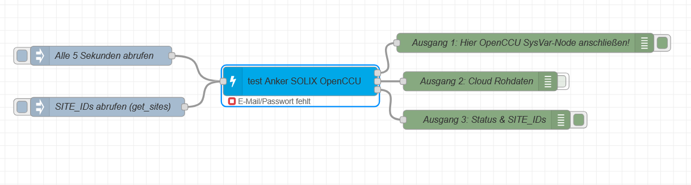
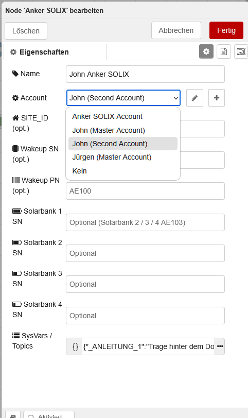
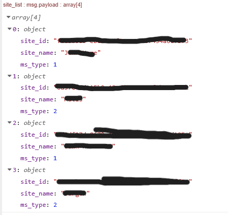
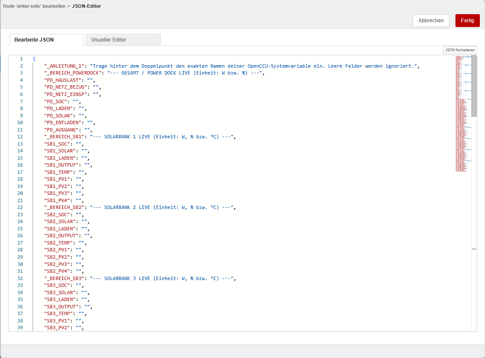

# node-red-contrib-anker-solix – English Documentation

⬅️ [Back to Main Page](README.md) | 🇩🇪 [Deutsche Anleitung](README.de.md)

---

## Table of Contents

1. [Installation](#installation)
2. [Upgrade & Migration Guide (`v1.0.x` → `v1.1.0`)](#upgrade--migration-guide-v10x--v110)
3. [Basic Setup & Account Node (`anker-solix-config`)](#basic-setup--account-node-anker-solix-config)
4. [Multi-Site Setup (`SITE_ID` & `get_sites`)](#multi-site-setup-site_id--get_sites)
5. [Device Control Node (`anker-solix-control`)](#device-control-node-anker-solix-control)
6. [Hardware Auto-Detection, Sleep Mode & Battery Protection](#hardware-auto-detection-sleep-mode--battery-protection)
7. [Output 1: Universal Message Format & Smart Home Examples](#output-1-universal-message-format--smart-home-examples)
8. [Copy-Pasteable JSON Template (126 Keys)](#copy-pasteable-json-template-126-keys)
9. [Complete Reference of All 126 Data Keys](#complete-reference-of-all-126-data-keys)
10. [Real-World Result](#real-world-result)

---

## Installation

Install directly via the **Node-RED Palette Manager** by searching for `node-red-contrib-anker-solix` or via SSH / terminal inside your Node-RED data directory (e.g., `/usr/local/addons/redmatic/var` on OpenCCU / RedMatic):

```bash
npm install node-red-contrib-anker-solix
```

Import a ready-to-use example flow via **Node-RED Menu > Import > Examples > node-red-contrib-anker-solix**.



---

## Upgrade & Migration Guide (`v1.0.x` → `v1.1.0`)

Starting with `v1.1.0`, cloud credentials have been moved into a dedicated **Account Configuration Node (`anker-solix-config`)** so that multiple data and control nodes can share a single account:

1. After updating, open your existing **`Anker SOLIX`** data node once.
2. Click the **pencil icon** next to **Account**, enter your **Email**, **Password**, and **Region** (`EU`, `US`, `AU`, `CN`), and click **Add / Update**.
3. Click **Deploy** — done!

* **Full Backward Compatibility:** All existing `SysVars / Topics` mappings (including legacy `v1.0.x` German keys such as `PD_HAUSLAST`, `SB1_LADEN`, `STAT_GES_TAG_*`), `SITE_ID`, serial numbers, and flow wires remain 100% intact and continue working without any changes.

---

## Basic Setup & Account Node (`anker-solix-config`)

1. Drag the **`Anker SOLIX`** data node into your flow and open its properties.
2. Click the pencil icon next to **Account** to create your **Anker SOLIX Account**:
   * **Email & Password:** Your Anker SOLIX app credentials (stored locally in Node-RED's encrypted credential store).
   * **Region:** Cloud server region of your account (`EU` for Europe/UK, `US` for North America, `AU` for Australia, `CN` for China).
   * **Timezone:** Local timezone of your system (e.g., `Europe/Berlin` or `America/New_York`).
3. **Single Site (`ms_type === 1`):** Leave `SITE_ID (opt.)` empty in the data node. The node automatically detects and caches your primary site.
4. **Hardware Serial Numbers:** Leave `Wakeup SN/PN` and `Solarbank 1–4 SN` empty for automatic discovery, or enter specific serial numbers to override auto-detection.
5. **Account Recommendation (Secondary vs. Primary Account):** Using a free, shared **secondary Anker account** is recommended for 24/7 read-only data monitoring (maximum security and clean separation). The **primary owner account** is only required for the **`Anker SOLIX Control`** node.


---

## Multi-Site Setup (`SITE_ID` & `get_sites`)

You only need **one shared account config node** for multiple sites (as long as all sites are visible in that account). Every Anker site has a globally unique `SITE_ID`:

1. Trigger the inject node with `msg.topic = "get_sites"`.
2. Read the list of all available `site_id` values at **Output 3** in the debug sidebar.
3. Paste the respective `site_id` into the `SITE_ID (opt.)` field of each data or control node.
4. When multiple data nodes are triggered simultaneously by a shared 5-second inject, an automatic **multi-instance start offset (`0–1,500 ms`)** staggers API requests cleanly without requiring manual delay nodes.



---

## Device Control Node (`anker-solix-control`)

The **`Anker SOLIX Control`** node allows you to switch usage modes and output power directly from Node-RED. It automatically detects and routes commands for **Power Dock (`AE100`)**, **Solarbank 4 E5000 Pro (`AE103`)**, **Solarbank 3 Pro (`A17C5`)**, **Solarbank 2**, and **Solarbank 1 (`A17C0`)**.

* **Important:** Write commands require your **primary owner account (`ms_type === 1`)** to be selected in the control node. If a shared member site is targeted, the node safely aborts with a clear message indicating that only the primary owner can control the site.
* **Instant Data Refresh:** After every successful write command, the site's wake-up lock is immediately reset so the data node fetches the updated state on the very next cycle.

### Supported Commands (`Command` or `msg.topic`)

| Command (`msg.topic`) | Values (`msg.payload`) | Description |
| :--- | :--- | :--- |
| **`set_usage_mode`** | `1`, `2`, `3`, or `7` | Switches the site's active usage mode:<br>• `1` = **Self-Consumption / Smart Meter**<br>• `2` = **Custom Mode / Schedule** (automatically creates a 24h fallback schedule `00:00–24:00` if none exists; configure custom time slots in the Anker app)<br>• `3` = **Smart Plug / Time-of-Use**<br>• `7` = **Smart Mode / AI EMS** |
| **`set_output_power`** | `0` .. `4800` *(Watts)* | Sets AC output power in Watts (primarily for standalone solarbanks without Power Dock; automatically rounded to the device's `step` increment). |
| **`from_msg`** | `{ command, value }` | Dynamic control via JSON payload or via `msg.topic` + `msg.payload`. |
| **`get_params`** | *(any)* | Reads current device parameters (`param_type` `6` or `4`) for diagnostics. |

---

## Hardware Auto-Detection, Sleep Mode & Battery Protection

Anker SOLIX solarbanks enter a **deep sleep mode** at night once the battery reaches its configured reserve SOC and only wake up again when solar power is available in the morning.

* **Systems with Power Dock (`AE100`), Anker Smart Meter (`A17X7`, `A17X8`, `AE1X0`, `AE1R0`, `SHEM3`), or AC Home Storage (`AE111`, `A17E1`, `A17E2`, `B17E2`):** These devices are permanently powered by AC mains. The node automatically uses them as the wake-up master (`cmd: 17` with randomized `3–4 min` jitter and automatic 90-second stall re-trigger) for uninterrupted 5-second real-time data while letting connected solarbanks rest safely.
* **Standalone Solarbank Systems (without Power Dock / Anker Smart Meter):** The node automatically disables MQTT wake-up by default (`OK (Battery protection: wakeup off)`).
* **Smart Meter Offline Monitoring:** `SITE_SMARTMETER_ONLINE` reports `1` (online) or `0` (offline / 200W fallback active). In addition, **Output 3** emits a one-shot alert message (`msg.topic = "alarm/smartmeter_offline"` or `"alarm/smartmeter_online"`) whenever the connection state changes.
* **Runtime Control Topics (Data Node):**
  * `msg.topic = "set_wakeup"`, `msg.payload = true` / `false` / `"auto"` (enable, disable, or return to automatic MQTT wake-up detection)
  * `msg.topic = "get_stats"` (fetch energy statistics in `kWh` immediately without waiting for the 300-second interval)
  * `msg.topic = "get_sites"` (list all available `SITE_ID` values on Output 3)

---

## Output 1: Universal Message Format & Smart Home Examples

For every key mapped in the JSON configuration, **Output 1** emits a standard Node-RED message (`{ topic: "Your_Target_Name", payload: 1245 }`) whenever its numeric value changes — plus every **300 seconds** as a heartbeat data point (preventing spline wave interpolation artifacts in CCU-Historian during constant phases).



| Target System | Example Entry in JSON Mapping | Connected Node at Output 1 |
| :--- | :--- | :--- |
| **OpenCCU / HomeMatic** | `"SITE_HOME_LOAD": "Leistung Hauslast"` | **`ccu-sysvar`** (uses `msg.topic` as variable name and `msg.payload` as value) |
| **MQTT Broker** *(Home Assistant, ioBroker)* | `"SITE_HOME_LOAD": "anker/solix/home_load"` | **`mqtt out`** (leave topic blank in MQTT node; uses `msg.topic` automatically) |
| **InfluxDB / Grafana** | `"SITE_HOME_LOAD": "home_load_w"` | **`influxdb out`** (writes `msg.payload` under the field name in `msg.topic`) |
| **KNX / Loxone** | `"SITE_HOME_LOAD": "1/2/10"` | **`knxUltimate`** or **`loxone-control-out`** |
---

## Copy-Pasteable JSON Template (126 Keys)

```json
{
  "_INFO_1": "Enter the name of your OpenCCU system variable (or MQTT topic) after the colon. Empty fields are ignored.",
  "_SECTION_SITE": "--- SITE / TOTAL LIVE (Unit: W, % or 0/1) ---",
  "SITE_HOME_LOAD": "", "SITE_GRID_IMPORT": "", "SITE_GRID_EXPORT": "", "SITE_SOC": "",
  "SITE_CHARGE": "", "SITE_AC_CHARGE": "", "SITE_SOLAR": "", "SITE_DISCHARGE": "",
  "SITE_OUTPUT": "", "SITE_SMARTMETER_ONLINE": "",
  "_SECTION_SB1": "--- SOLARBANK 1 LIVE (Unit: W or %) ---",
  "SB1_SOC": "", "SB1_SOLAR": "", "SB1_CHARGE": "", "SB1_AC_CHARGE": "", "SB1_OUTPUT": "",
  "SB1_PV1": "", "SB1_PV2": "", "SB1_PV3": "", "SB1_PV4": "",
  "_SECTION_SB2": "--- SOLARBANK 2 LIVE (Unit: W or %) ---",
  "SB2_SOC": "", "SB2_SOLAR": "", "SB2_CHARGE": "", "SB2_AC_CHARGE": "", "SB2_OUTPUT": "",
  "SB2_PV1": "", "SB2_PV2": "", "SB2_PV3": "", "SB2_PV4": "",
  "_SECTION_SB3": "--- SOLARBANK 3 LIVE (Unit: W or %) ---",
  "SB3_SOC": "", "SB3_SOLAR": "", "SB3_CHARGE": "", "SB3_AC_CHARGE": "", "SB3_OUTPUT": "",
  "SB3_PV1": "", "SB3_PV2": "", "SB3_PV3": "", "SB3_PV4": "",
  "_SECTION_SB4": "--- SOLARBANK 4 LIVE (Unit: W or %) ---",
  "SB4_SOC": "", "SB4_SOLAR": "", "SB4_CHARGE": "", "SB4_AC_CHARGE": "", "SB4_OUTPUT": "",
  "SB4_PV1": "", "SB4_PV2": "", "SB4_PV3": "", "SB4_PV4": "",
  "_SECTION_STAT_SITE": "--- SITE STATISTICS (Unit: kWh) ---",
  "STAT_DAY_SOLAR": "", "STAT_DAY_CHARGE": "", "STAT_DAY_DISCHARGE": "", "STAT_DAY_SOLAR_HOME": "",
  "STAT_DAY_GRID_EXPORT": "", "STAT_DAY_GRID_IMPORT": "", "STAT_DAY_HOME": "", "STAT_DAY_BAT_HOME": "",
  "STAT_WEEK_SOLAR": "", "STAT_WEEK_CHARGE": "", "STAT_WEEK_DISCHARGE": "", "STAT_WEEK_SOLAR_HOME": "",
  "STAT_WEEK_GRID_EXPORT": "", "STAT_WEEK_GRID_IMPORT": "", "STAT_WEEK_HOME": "", "STAT_WEEK_BAT_HOME": "",
  "STAT_MONTH_SOLAR": "", "STAT_MONTH_CHARGE": "", "STAT_MONTH_DISCHARGE": "", "STAT_MONTH_SOLAR_HOME": "",
  "STAT_MONTH_GRID_EXPORT": "", "STAT_MONTH_GRID_IMPORT": "", "STAT_MONTH_HOME": "", "STAT_MONTH_BAT_HOME": "",
  "STAT_YEAR_SOLAR": "", "STAT_YEAR_CHARGE": "", "STAT_YEAR_DISCHARGE": "", "STAT_YEAR_SOLAR_HOME": "",
  "STAT_YEAR_GRID_EXPORT": "", "STAT_YEAR_GRID_IMPORT": "", "STAT_YEAR_HOME": "", "STAT_YEAR_BAT_HOME": "",
  "_SECTION_STAT_SB1": "--- SOLARBANK 1 STATISTICS (Unit: kWh) ---",
  "STAT_SB1_DAY_SOLAR": "", "STAT_SB1_DAY_CHARGE": "", "STAT_SB1_DAY_DISCHARGE": "",
  "STAT_SB1_WEEK_SOLAR": "", "STAT_SB1_WEEK_CHARGE": "", "STAT_SB1_WEEK_DISCHARGE": "",
  "STAT_SB1_MONTH_SOLAR": "", "STAT_SB1_MONTH_CHARGE": "", "STAT_SB1_MONTH_DISCHARGE": "",
  "STAT_SB1_YEAR_SOLAR": "", "STAT_SB1_YEAR_CHARGE": "", "STAT_SB1_YEAR_DISCHARGE": "",
  "_SECTION_STAT_SB2": "--- SOLARBANK 2 STATISTICS (Unit: kWh) ---",
  "STAT_SB2_DAY_SOLAR": "", "STAT_SB2_DAY_CHARGE": "", "STAT_SB2_DAY_DISCHARGE": "",
  "STAT_SB2_WEEK_SOLAR": "", "STAT_SB2_WEEK_CHARGE": "", "STAT_SB2_WEEK_DISCHARGE": "",
  "STAT_SB2_MONTH_SOLAR": "", "STAT_SB2_MONTH_CHARGE": "", "STAT_SB2_MONTH_DISCHARGE": "",
  "STAT_SB2_YEAR_SOLAR": "", "STAT_SB2_YEAR_CHARGE": "", "STAT_SB2_YEAR_DISCHARGE": "",
  "_SECTION_STAT_SB3": "--- SOLARBANK 3 STATISTICS (Unit: kWh) ---",
  "STAT_SB3_DAY_SOLAR": "", "STAT_SB3_DAY_CHARGE": "", "STAT_SB3_DAY_DISCHARGE": "",
  "STAT_SB3_WEEK_SOLAR": "", "STAT_SB3_WEEK_CHARGE": "", "STAT_SB3_WEEK_DISCHARGE": "",
  "STAT_SB3_MONTH_SOLAR": "", "STAT_SB3_MONTH_CHARGE": "", "STAT_SB3_MONTH_DISCHARGE": "",
  "STAT_SB3_YEAR_SOLAR": "", "STAT_SB3_YEAR_CHARGE": "", "STAT_SB3_YEAR_DISCHARGE": "",
  "_SECTION_STAT_SB4": "--- SOLARBANK 4 STATISTICS (Unit: kWh) ---",
  "STAT_SB4_DAY_SOLAR": "", "STAT_SB4_DAY_CHARGE": "", "STAT_SB4_DAY_DISCHARGE": "",
  "STAT_SB4_WEEK_SOLAR": "", "STAT_SB4_WEEK_CHARGE": "", "STAT_SB4_WEEK_DISCHARGE": "",
  "STAT_SB4_MONTH_SOLAR": "", "STAT_SB4_MONTH_CHARGE": "", "STAT_SB4_MONTH_DISCHARGE": "",
  "STAT_SB4_YEAR_SOLAR": "", "STAT_SB4_YEAR_CHARGE": "", "STAT_SB4_YEAR_DISCHARGE": ""
}
```

---

## Complete Reference of All 126 Data Keys

*(All legacy `v1.0.x` German keys such as `PD_HAUSLAST`, `SB1_LADEN`, and `STAT_GES_TAG_*` continue to work automatically via the built-in backward-compatibility alias bridge.)*

### Site / Total Live (10 Keys)
* `SITE_HOME_LOAD` (W): Current home power consumption *(Legacy: `PD_HAUSLAST`)*
* `SITE_GRID_IMPORT` (W): Grid import power *(Legacy: `PD_NETZ_BEZUG`)*
* `SITE_GRID_EXPORT` (W): Grid export power *(Legacy: `PD_NETZ_EINSP`)*
* `SITE_SOC` (%): Total system battery state of charge *(Legacy: `PD_SOC`)*
* `SITE_CHARGE` (W): Total battery charging power (PV + AC) *(Legacy: `PD_LADEN`)*
* `SITE_AC_CHARGE` (W): Total AC grid-to-battery charging power *(new in v1.1.0)*
* `SITE_SOLAR` (W): Total PV solar generation power *(Legacy: `PD_SOLAR`)*
* `SITE_DISCHARGE` (W): Total battery discharging power *(Legacy: `PD_ENTLADEN`)*
* `SITE_OUTPUT` (W): Total system AC output power *(Legacy: `PD_AUSGANG`)*
* `SITE_SMARTMETER_ONLINE` (`1`/`0`): Smart Meter connection status (`1` = online, `0` = offline / 200W fallback active) *(new in v1.1.0)*

### Individual Solarbanks 1–4 Live (4 × 9 = 36 Keys)
*(Replace `X` with `1`, `2`, `3`, or `4`)*
* `SBX_SOC` (%): Battery state of charge
* `SBX_SOLAR` (W): Total PV solar input power
* `SBX_CHARGE` (W): Total battery charging power *(Legacy: `SBX_LADEN`)*
* `SBX_AC_CHARGE` (W): AC grid-to-battery charging power *(new in v1.1.0)*
* `SBX_OUTPUT` (W): AC output power
* `SBX_PV1` .. `SBX_PV4` (W): Individual MPPT string 1–4 power

### Total Energy Statistics (4 Periods × 8 = 32 Keys, Unit: `kWh`)
*(Replace `PERIOD` with `DAY`, `WEEK`, `MONTH`, or `YEAR` — Legacy: `TAG`, `WOCHE`, `MONAT`, `JAHR`)*
* `STAT_PERIOD_SOLAR` (kWh): Total solar yield *(Legacy: `STAT_GES_*_SOLAR`)*
* `STAT_PERIOD_CHARGE` (kWh): Total energy charged into battery *(Legacy: `STAT_GES_*_LADEN`)*
* `STAT_PERIOD_DISCHARGE` (kWh): Total energy discharged from battery *(Legacy: `STAT_GES_*_ENTLADEN`)*
* `STAT_PERIOD_SOLAR_HOME` (kWh): Direct solar consumption by home *(Legacy: `STAT_GES_*_SOLAR_HAUS`)*
* `STAT_PERIOD_GRID_EXPORT` (kWh): Total energy exported to grid *(Legacy: `STAT_GES_*_EINSP`)*
* `STAT_PERIOD_GRID_IMPORT` (kWh): Total energy imported from grid *(Legacy: `STAT_GES_*_NETZ`)*
* `STAT_PERIOD_HOME` (kWh): Total home energy consumption *(Legacy: `STAT_GES_*_HAUS`)*
* `STAT_PERIOD_BAT_HOME` (kWh): Home consumption supplied from battery *(Legacy: `STAT_GES_*_BAT_HAUS`)*

### Individual Solarbanks 1–4 Statistics (4 Banks × 4 Periods × 3 = 48 Keys, Unit: `kWh`)
*(Replace `X` with `1`–`4` and `PERIOD` with `DAY`, `WEEK`, `MONTH`, or `YEAR`)*
* `STAT_SBX_PERIOD_SOLAR` (kWh): Solar yield of Solarbank X
* `STAT_SBX_PERIOD_CHARGE` (kWh): Charged energy of Solarbank X *(Legacy: `STAT_SBX_*_LADEN`)*
* `STAT_SBX_PERIOD_DISCHARGE` (kWh): Discharged energy of Solarbank X *(Legacy: `STAT_SBX_*_ENTLADEN`)*

---

## Real-World Result

Continuous 5-second real-time recording in CCU-Historian without cloud polling gaps:


