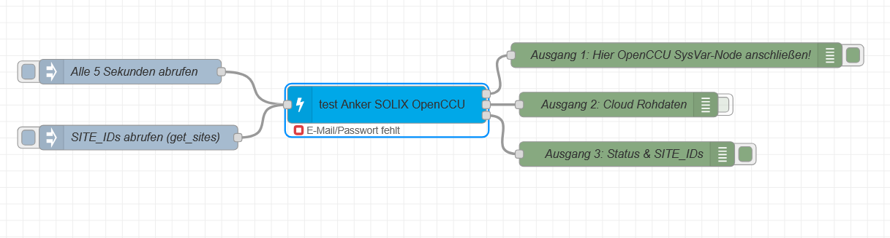
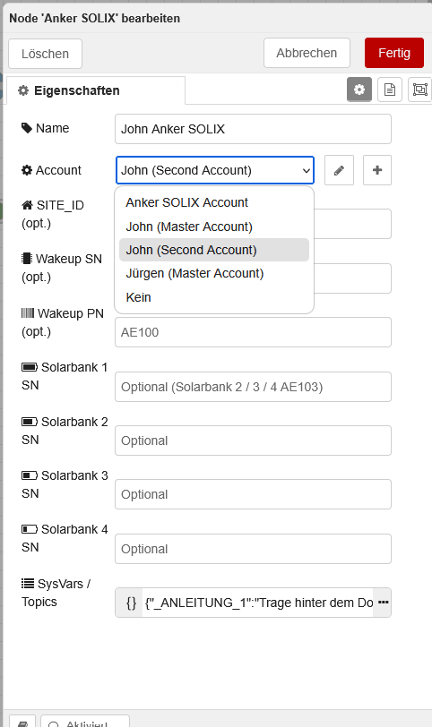

# node-red-contrib-anker-solix

  

🌐 **Language / Sprache:** [🇬🇧 English Overview](#overview-english) ([Full English Docs](README.en.md)) | [🇩🇪 Kurzübersicht Deutsch](#kurzübersicht-deutsch) ([Vollständige deutsche Anleitung](README.de.md))

---

## 🇬🇧 Overview (English)

Node-RED nodes to read real-time data (`W`, `%`, Smart Meter status), AC charging power, and energy statistics (`kWh`) — and to switch usage modes — for **Anker SOLIX Solar & Energy Storage Systems** (**Solarbank 1/2/3 Pro/4 E5000 Pro `AE103`**, **Solarbank Max `AE111`**, **Solarbank Max AC `A17E2`/`B17E2`**, **SOLIX E10 `A17E1`**, **Power Dock `AE100`**, and **Anker Smart Meters**) via the **Anker Cloud (`EU` / `US` / `AU` / `CN`)**.

* **3-Node Architecture (`config` + `data` + `control`):**
  * **`anker-solix-config`:** Central account node with global server region selection (`EU`, `US`, `AU`, `CN`). Share one account across multiple sites via `SITE_ID`, or use a secondary read-only account for polling with an optional **Wakeup Account** (`wakeupServer`) on the primary owner account for MQTT wake-ups.
  * **`anker-solix` (Data Node — 126 Data Keys):** Emits delta-filtered `{ topic, payload }` messages (with a 300-second heartbeat for flatline-free charts in CCU-Historian / InfluxDB) directly to **OpenCCU / HomeMatic** (`ccu-sysvar`), **MQTT Brokers** (`mqtt out` for Home Assistant / ioBroker), **InfluxDB**, or **KNX / Loxone** — plus raw JSON (`scen_info` & `energy_analysis`) on Output 2 and Smart Meter offline alarms (`SITE_SMARTMETER_ONLINE`) on Output 3.
  * **`anker-solix-control` (Control Node):** Safely switches usage modes (`1` Self-Consumption, `2` Custom/Schedule, `3` Smart Plug, `7` AI Smart Mode) and standalone output power (`set_output_power`, clamped to device limits) using your primary owner account.
* **Smart Hardware Auto-Detection & Battery Protection:** Automatically detects Power Dock (`AE100`), Anker Smart Meters (`A17X7`, `A17X8`, `AE1X0`, `AE1R0`, `SHEM3`), and AC-coupled home storage (`AE111`, `A17E1`, `A17E2`, `B17E2`) for continuous 24/7 real-time updates, while keeping standalone solarbanks in battery-safe sleep mode at night.
* **Full Legacy Compatibility:** Standardized English keys (`SITE_*`, `SB1_*`..`SB4_*`, `STAT_*`) work side-by-side with automatic backward compatibility for all `v1.0.x` German keys.

### Visual Quick Start

👉 **[Read the full English Documentation (Installation, Migration, SysVars, MQTT & Control Commands)](README.en.md)**
---

#### Latest Release: v1.1.2 (Maintenance Release)

* **Separate Wakeup Account (`wakeupServer`):** Poll via a secondary account while sending MQTT `cmd: 17` wake-ups through the primary owner account (`ms_type === 1`) to prevent 5-minute standby waves and app session conflicts.
* **Control Power Clamping & Instant Wake-Up Reset:** Clamps `set_output_power` to valid limits (`0..800 W` on `SB_GEN1` / `A17C0`, `0..max_load` / `4800 W` otherwise) and resets the wake-up cooldown after control writes.
* **Clean Packaging & Lifecycle Stability:** Added `files` allowlist in `package.json`, excluded `node_modules` in `build.bat`, added per-node `nodeTag` to MQTT `clientId`s, and cleared cached site/device IDs when `siteId` changes on `close`.
* **Troubleshooting Tip (Power Dock Constellation):** If real-time values fall back to 5-minute intervals despite active MQTT wake-up, open the Anker app once with the **primary owner account (`ms_type === 1`)** to confirm the device constellation/setup in the app.
* **Migration Note (`v1.0.x` -> `v1.1.x`):** After updating from `v1.0.x`, open your existing `Anker SOLIX` node once, click the pencil icon next to **Account**, and enter your **Email**, **Password**, and **Region** in the new `anker-solix-config` node. All existing SysVars mappings, `SITE_ID`, serial numbers, and wires remain intact.

---

### Planned Roadmap (Unbinding / Subject to Change)

* **`v2.0.x`:**
  * Extended support for the wider Anker SOLIX ecosystem: **Anker Smart Plugs** (`smart_plug_info`: power monitoring & switching), **V1 Smart EV Charger (`A5191`)**, **SOLIX X1 Home Energy Storage**, and **portable power stations / backup units (`pps_info` / `powerpanel_list`)**.

---

### Legal Notice, Transparency & Disclaimer (English)

* **Unofficial Community Project:** This Node-RED package (`node-red-contrib-anker-solix`) is an independent open-source community project and is **not affiliated with, endorsed, or supported by Anker Innovations Limited or Anker SOLIX**. All product names and trademarks belong to their respective owners.
* **Transparency & Development:** Conception, architecture, practical testing, and maintenance are provided by the project author; code generation was assisted by AI (**Google Gemini**).
* **Use at Your Own Risk:** Provided under the **MIT License** without warranty of any kind. Using the unofficial cloud interface is at your own risk. The author assumes no liability for temporary account restrictions, data loss, battery discharge, or damages resulting from the use of this node or changes to the Anker API.
* **Privacy:** Email address and password are stored exclusively locally in Node-RED's encrypted credential storage (`flows_cred.json`) and transmitted only to official Anker Cloud servers.

---

## 🇩🇪 Kurzübersicht (Deutsch)

Node-RED-Bausteine zum Auslesen von Echtzeit- (`W`, `%`, Smart-Meter-Status), AC-Lade- (`SITE_AC_CHARGE`) und Statistikdaten (`kWh`) sowie zum Umschalten der Betriebsmodi für **Anker SOLIX Solar- & Speichersysteme** (**Solarbank 1/2/3 Pro/4 E5000 Pro `AE103`**, **Solarbank Max `AE111`**, **Solarbank Max AC `A17E2`/`B17E2`**, **SOLIX E10 `A17E1`**, **Power Dock `AE100`** sowie **Anker Smart Meter**) über die **Anker Cloud (`EU` / `US` / `AU` / `CN`)**.

* **3-Node-Architektur (`config` + `data` + `control`):**
  * **`anker-solix-config`:** Zentraler Account-Baustein mit Server-Regionsauswahl (`EU`, `US`, `AU`, `CN`). Ein Konto kann über die `SITE_ID` für mehrere Anlagen genutzt werden – oder ein geteiltes **Zweitkonto** liest die Daten aus, während über **Wakeup Account** das **Hauptkonto** die MQTT-Wakeups ausführt.
  * **`anker-solix` (Daten-Baustein — 126 Datenpunkte):** Sendet Werte bei Änderung (sowie alle 300 Sekunden als Stützpunkt gegen Spline-Wellen in CCU-Historian / InfluxDB) direkt an **OpenCCU / HomeMatic** (`ccu-sysvar`), **MQTT-Broker** (`mqtt out` für Home Assistant / ioBroker), **InfluxDB** oder **KNX / Loxone** – plus Rohdaten (`scen_info` & `energy_analysis`) an Ausgang 2 und Smart-Meter-Ausfall-Alarm (`SITE_SMARTMETER_ONLINE`) an Ausgang 3.
  * **`anker-solix-control` (Steuerungs-Baustein):** Wechselt Betriebsmodi (`1` Eigenverbrauch, `2` Benutzerdefiniert/Manuell, `3` Smart Plug, `7` KI-Modus) und Einzel-Solarbank-Leistung (`set_output_power`, sauber auf Grenzwerte geklemmt) über das Hauptkonto (Eigentümer).
* **Praxistipp (Konstellationsbestätigung):** Falls die Werte trotz Wakeup auf 5-Minuten-Takt zurückfallen, einmal mit dem **Hauptkonto (`ms_type === 1`)** in der Anker-App öffnen und die Geräte-/Anlagenkonstellation bestätigen.
* **Update-Hinweis (`v1.0.x` -> `v1.1.x`):** Nach dem Update einmalig den bestehenden `Anker SOLIX`-Node öffnen, neben **Account** auf das Stift-Symbol klicken und **E-Mail**, **Passwort** sowie **Region** im neuen Account-Config-Node eintragen. Alle bestehenden SysVars-Zuordnungen (inkl. alter deutscher Keys), `SITE_ID`, Seriennummern und Leitungen bleiben komplett erhalten.

👉 **[Zur vollständigen deutschen Anleitung (Installation, Migration, Systemvariablen, MQTT & Steuerbefehle)](README.de.md)**

### Rechtliche Hinweise, Transparenz & Haftungsausschluss (Deutsch)

* **Unabhängiges Community-Projekt:** Dieses Node-RED-Paket (`node-red-contrib-anker-solix`) ist ein privates Open-Source-Projekt und steht in **keiner Verbindung zu Anker Innovations Limited oder Anker SOLIX**. Alle genannten Marken- und Produktnamen sind Eigentum der jeweiligen Rechteinhaber.
* **Transparenz & Entstehung:** Konzeption, Architektur, Praxistests und Pflege stammen vom Projektautor; die Code-Erstellung erfolgte mit KI-Unterstützung (**Google Gemini**).
* **Nutzung auf eigene Gefahr:** Die Bereitstellung erfolgt unter der **MIT-Lizenz** ohne jegliche Gewährleistung. Die Nutzung der inoffiziellen Cloud-Schnittstelle erfolgt auf eigenes Risiko. Der Autor übernimmt keine Haftung für temporäre Kontosperrungen, Datenverluste, Akku-Entladungen oder Schäden, die durch die Nutzung dieses Bausteins oder durch Änderungen an der Anker-API entstehen.
* **Datenschutz:** E-Mail-Adresse und Passwort werden ausschließlich lokal im verschlüsselten Credential-Speicher deiner Node-RED-Instanz (`flows_cred.json`) abgelegt und nur für die direkte Authentifizierung bei den Anker-Servern verwendet.